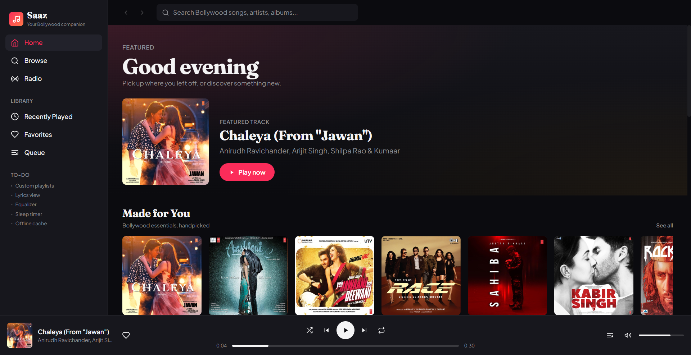
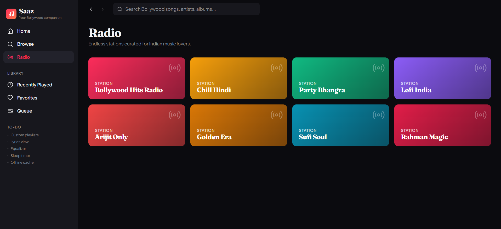
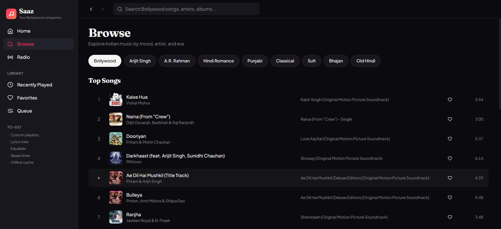

<div align="center">
  

  # 🎵 Saaz Music

  ### Your Bollywood Music Player

  <p>
    A clean, fast and responsive web music player for Hindi songs, powered by the iTunes Search API.<br/>
    Discover, search, queue and favorite tracks with an experience inspired by modern music apps.
  </p>

  
  
  
  
  

  <br/><br/>

  [**Live Demo**](https://isongs.vercel.app/) · [**Report a Bug**](../../issues) · [**Request a Feature**](../../issues)
</div>

> [!NOTE]
> Saaz Music uses the free iTunes Search API, which only provides **30-second previews** of songs. This project is built for learning and demonstration, not as a replacement for a full streaming service.

---

## 📑 Table of Contents

- [Preview](#-preview)
- [Features](#-features)
- [Browse Categories](#-browse-categories)
- [Getting Started](#-getting-started)
- [How It Works](#-how-it-works)
- [Project Structure](#-project-structure)
- [Tech Stack](#️-tech-stack)
- [Design Highlights](#-design-highlights)
- [Known Limitations](#️-known-limitations)
- [Roadmap](#️-roadmap)
- [Contributing](#-contributing)
- [License](#-license)
- [Acknowledgements](#-acknowledgements)

---

## 📸 Preview

<div align="center">
  
  
  <br/><br/>
  
 
</div>


---

## ✨ Features

<div align="center">
  <table>
    <tr>
      <td align="center" width="33%">
        
        <br><strong>Home</strong>
        <br>Curated playlists and suggestions
      </td>
      <td align="center" width="33%">
        
        <br><strong>Browse</strong>
        <br>Search songs, artists and moods
      </td>
      <td align="center" width="33%">
        
        <br><strong>Radio</strong>
        <br>Endless, continuous playback
      </td>
    </tr>
    <tr>
      <td align="center">
        
        <br><strong>Recently Played</strong>
        <br>Pick up where you left off
      </td>
      <td align="center">
        
        <br><strong>Favorites</strong>
        <br>Save the songs you love
      </td>
      <td align="center">
        
        <br><strong>Queue</strong>
        <br>Control what plays next
      </td>
    </tr>
  </table>
</div>

---

## 🎶 Browse Categories

| Category | Vibe |
|----------|------|
| 🎬 **Bollywood** | Latest Hindi hits |
| 🎤 **Arijit Singh** | Popular romantic songs |
| 🎹 **A.R. Rahman** | Music from the legendary composer |
| ❤️ **Romantic** | Love songs for every mood |
| 🥁 **Punjabi** | High-energy beats |
| 🪕 **Classical** | Traditional Indian music |
| 🌙 **Sufi** | Soulful, spiritual tracks |
| 🙏 **Devotional** | Bhajans and prayers |
| 📻 **Retro** | Timeless old classics |

---

## 🚀 Getting Started

### Prerequisites

- A modern web browser (Chrome, Firefox, Edge, Safari)
- An active internet connection

No build step, no dependencies, no API key required.

### Run Locally

```bash
# 1. Clone the repository
git clone https://github.com/<your-username>/saaz-music.git

# 2. Move into the project folder
cd saaz-music

# 3. Open index.html in your browser
#    or serve it with any static server:
npx serve .
# or
python -m http.server 8000
```

Then visit `http://localhost:8000`.

### Usage

| Tab | What you can do |
|-----|-----------------|
| **Home** | Explore playlists and suggestions |
| **Browse** | Search songs, artists and categories |
| **Radio** | Listen to songs back to back |
| **Library** | View favorites and listening history |

---

## 🔍 How It Works

Saaz Music queries the public iTunes Search API and plays the `previewUrl` returned for each track.

```js
const query = encodeURIComponent("Arijit Singh");
const url = `https://itunes.apple.com/search?term=${query}&entity=song&country=IN&limit=25`;

const res = await fetch(url);
const { results } = await res.json();

// Useful fields on each result:
// trackName, artistName, artworkUrl100, previewUrl, collectionName
```

Favorites and recently played songs are stored in the browser, so they stay on your device between visits.

---

## 📁 Project Structure

```text
saaz-music/
├── index.html        # App markup and layout
├── script.js         # Player logic, API calls, state
├── style.css         # Custom styles and animations
├── icon.png          # App logo
└── screenshots/      # README images
```

> Update this tree to match your actual files.

---

## 🛠️ Tech Stack

<div align="center">
  
  
  
  
  
</div>

---

## 🎨 Design Highlights

- 🌙 Dark theme that's easy on the eyes
- 📱 Fully responsive across mobile and desktop
- 🧼 Simple, distraction-free layout
- ✨ Smooth transitions and animations
- 🔣 Icon-driven navigation

---

## ⚠️ Known Limitations

- Playback is limited to **30-second previews** (an iTunes API restriction).
- Song availability depends on the iTunes catalog for your region.
- Favorites and history are stored locally and are not synced across devices.

---

## 🗺️ Roadmap

- [x] Home, Browse and Radio
- [x] Favorites and Recently Played
- [x] Queue management
- [ ] Custom playlists
- [ ] Keyboard shortcuts (space, next, previous)
- [ ] Shuffle and repeat modes
- [ ] Light theme toggle
- [ ] Installable PWA with offline shell
- [ ] Lyrics integration

Have an idea? [Open an issue](../../issues) and let's talk.

---

## 🤝 Contributing

Contributions make open source great. Any help is appreciated!

1. **Fork** the project
2. **Create** your feature branch: `git checkout -b feature/amazing-feature`
3. **Commit** your changes: `git commit -m "Add amazing feature"`
4. **Push** to the branch: `git push origin feature/amazing-feature`
5. **Open** a Pull Request

---

## 📄 License

Distributed under the **MIT License**. See [`LICENSE`](LICENSE) for details.

---

## 🙏 Acknowledgements

- [iTunes Search API](https://developer.apple.com/library/archive/documentation/AudioVideo/Conceptual/iTuneSearchAPI/) for song data and previews
- [Tailwind CSS](https://tailwindcss.com/) for styling
- [Icons8](https://icons8.com/) for icons
- [Shields.io](https://shields.io/) for badges

> [!IMPORTANT]
> Song previews, artwork and metadata belong to their respective artists and rights holders. This project is not affiliated with or endorsed by Apple Inc.

<div align="center">
  <br/>
  If you like this project, give it a ⭐ on GitHub!
</div>
